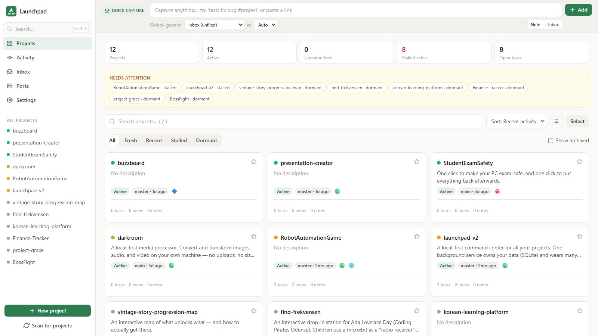

# Launchpad

A local command center for all my projects. One background service owns the data (SQLite) and has several "faces": a desktop window that starts with Windows, a localhost page you can open in any browser, and a CLI that AI agents use to read and write project notes.



*Screenshot from a demo database, not my real one.*

**Status:** in daily use on my own machine. Windows only, and it needs Node 24+.

## Why I made it

I have a lot of projects going at the same time, and I work on them with AI coding agents in several sessions in parallel. Notes, ideas and to-dos ended up spread over markdown files in each repo, chat histories and my head, and agents kept working from notes that were out of date.

Launchpad is my answer to that. It finds my projects on disk, shows their real status from git (so there is nothing to keep updated by hand), launches them in one click, and keeps notes, ideas and tasks for each project in one database. Agents get a CLI, so they read and write to the same place I do.

## What it does

- **Finds and tracks projects** under one or more root folders, and reads git status, last commit, branch, etc. Projects that haven't been touched in a while are marked as stalled or dormant.
- **Launches things:** open in the editor, a terminal, the folder, GitHub, the live site, or start the dev server.
- **Tasks, ideas and notes** per project, plus quick capture from anywhere (type `task: fix bug #project`).
- **Port registry,** so two projects don't claim the same dev-server port.
- **Live sites:** with a Vercel token it matches projects to their deployments.
- **Agent CLI** (`launchpad`). An agent run inside a project folder automatically targets that project. Writes are merge-only, agents can archive but never delete, a backup is taken before every bulk change, and every write is logged with who made it (UI, CLI, agent or import).

## How it is built

```
Your project folders ──reads git/files/README──► Launchpad service (Node + SQLite)
                                                   ├── REST API + web UI  (localhost:7420)
                                                   ├── git + filesystem scanner
                                                   └── launcher + scaffolder
                                                          │
                          Desktop window (Electron, tray, starts at login) ─┘
                          Any browser  ─────────────────────────────────────┘
```

- **Server:** Node 24 with Fastify and the built-in `node:sqlite`, so there is nothing native to compile.
- **UI:** React, Vite and Tailwind.
- **Desktop:** Electron is only a thin window and tray that points at localhost. It never loads SQLite itself, which avoids the usual native-module problems. A code change never requires reinstalling the app - the installed shell reads the server and UI from the working copy.
- **One source of truth:** the database. The markdown files in each repo are a one-way export.

The reasoning behind the bigger decisions is in [`ai-instructions/WORKING_NOTES.md`](ai-instructions/WORKING_NOTES.md).

## Running it

```bash
npm install
npm run build
npm start
```

Then open http://localhost:7420, go to **Settings** and pick the folder your projects are in. Development mode, the desktop app, the installer and the agent CLI are covered in [`docs/DEVELOPMENT.md`](docs/DEVELOPMENT.md).
